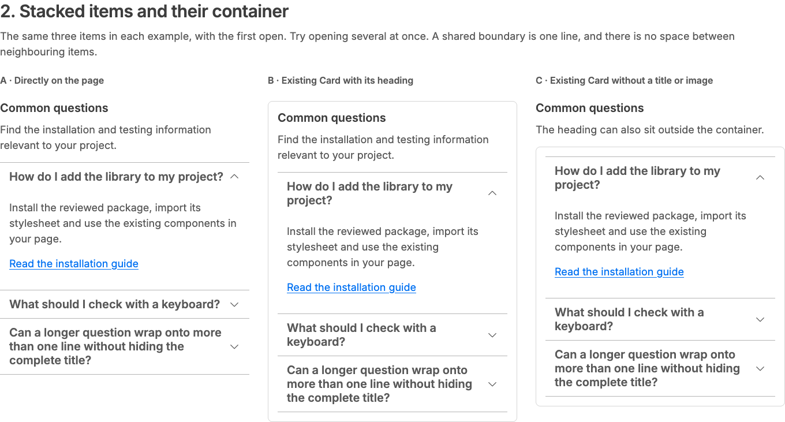
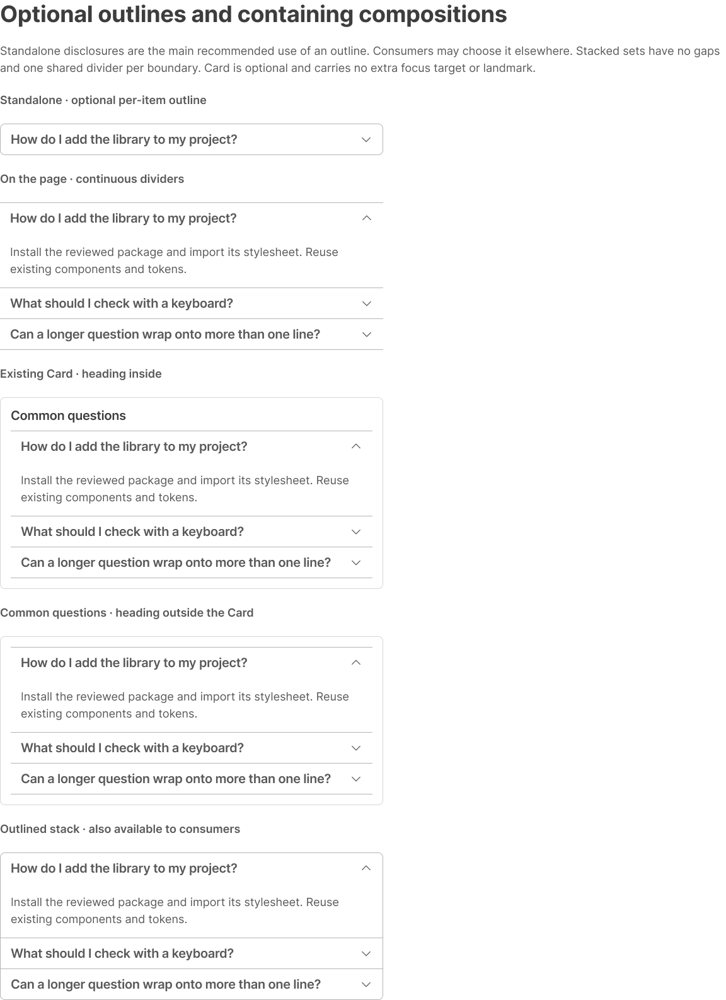
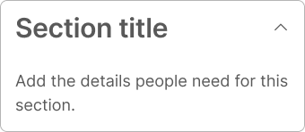
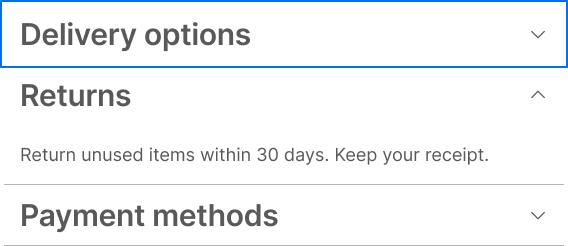

# Accordion — optional outline and continuous stack review

29 October 2026. Richard accepted the local comparison and requested the existing component workflow. Branch `feat/accordion-boundary` starts from `0ed62dbc2b2aa1320ef3794bd23f6faa9e65d9c9`. This is a source and unpublished Figma review; merge, the changed existing alias provider pull, publication and site adoption remain separate checkpoints.

## Accepted scope and implementation

- `outlined?: boolean`, default **false**, adds a per-item outline. Standalone disclosures are the main recommended use case; other consumer compositions remain supported.
- Every stack has zero gaps, first/top and last/bottom boundaries and one shared divider at each join. An outlined stack adds side borders and rounds only exposed outer corners; a standalone item has all four rounded corners. Expanded content remains inside its item.
- Existing native headings/buttons, independent expansion, mounted content, state ownership, IDs, refs, default absence of panel landmarks, focus recovery, progressive enhancement and print behaviour are retained. Outline is presentation only.
- Card is an independent optional container for a coherent topic. Its heading, image and actions are optional; its content-only shell can contain Accordion. The page owns section semantics and heading hierarchy. No Panel component or whole-container interaction is added.
- SideMenu and ResponsiveSideMenu retain their reviewed bottom-only inset divider and previous geometry through package composition CSS. Navigation has no new outline option.

The working comparison at `?accordion-boundary-review` imports the real package. Its CSS owns only review-page composition. The earlier prototype, selected-colour experiments and VoiceOver diagnostic page remain local and are excluded from delivery.

## Tokens

**No new primitive, semantic or component token.** One existing alias changes:

| Existing token | Previous alias | New alias | Result |
| --- | --- | --- | --- |
| `component.accordion.spacing.itemGap` | `spacing.stack.sm` | `spacing.0` | 8px → 0px |

GAP scope and exact Web syntax are preserved. Source JSON regenerates both compiled outputs; generated files are not independently edited. The outline uses existing default border/thin width, radius.lg/none, surface, type, insets and focus roles. All nine contract text/caret/focus contrast pairs pass; [resolved ratios](accordion-boundary/contrast.json). Borders are decorative; visible text, caret and native state continue to identify the control.

The live Figma global alias remains unchanged until source is merged and pulled through Tokens Studio. Unpublished candidate Items slots bind the existing `spacing/0` variable. After the routine non-destructive global export, rebind them to the existing `component/accordion/spacing/itemGap` identity and repeat the audit. Never recreate the manual Breakpoint collection or push Tokens Studio state to GitHub.

## Automated validation

- Library build, source/consumer type checks and preview production build passed.
- **139 unit checks** across 13 files passed, including outline default/opt-in, stable relationships, expansion retention across presentation changes and runtime rejection of non-boolean values.
- **116 browser checks passed**, including six new boundary regressions: zero-gap/single-edge geometry; native keyboard and independent expansion; focus through hover/keyboard activation; 320px with doubled text/spacing and forced colours; preserved navigation composition; no-JavaScript/print; Card semantics and automated accessibility/contrast.
- Packed **React 18.3.1 and React 19.3.1** consumers passed, including the same positive/negative public type fixtures and SSR/hydration/ref coverage. Package has 74 files; no dependency change or publication.
- YAML and JSON parsing, all nine resolved contrast pairs and whitespace checks passed. The token rebuild is repeatable, with only the existing item-gap alias and description changed.

The first browser run found two errors in the newly added checks: a locator keypress refocused the trigger before Shift+Tab, and forced-colour focus was asserted while pointer modality was still active. They were corrected to use actual sequential keyboard navigation and keyboard activation. No interaction code was changed to make those tests pass. Existing suites and the final full browser run passed.

These checks do not establish real screen-reader speech or certify application conformance. No new manual assistive-technology acceptance is claimed. Wider VoiceOver/Safari, NVDA, touch, actual zoom and Windows high-contrast checks remain release acceptance.

## Figma result

Existing [21 - Components - Accordion](https://www.figma.com/design/dVFI0q1cXMtmjUAkdvSWkk?node-id=1176-101) retains its four areas, original Title/Item/root component identities, existing caret components and responsive styles. The [machine-readable receipt](react-accordion-boundary-figma-evidence.json) records exact nodes and repairs.

| Asset | ID |
| --- | --- |
| Existing Item set, now 12 variants | `1176:182` |
| Existing root with native Items slot | `1176:183` |
| New boundary and Card examples | `1647:668` |
| New 320 / 768 / 1152px QA cases | `1647:1275` |
| Existing Card master reused | `1180:630` |

Outlined=False/True joins Expanded=False/True and State=Default/Hover/Pressed. Focus remains an independent boolean. All twelve variants have native Content slots referencing the same existing property. Figma clone operations initially flattened those slots and dropped focus visibility references; both were repaired and audited. Joined outlined instances bind existing `border.width.none` on interior top strokes and `radius.none` at interior corners. The Top divider helper is Figma authoring guidance, not another React prop.

Examples use actual static Card instances, with heading inside or outside the content-only container. No new Card/Panel master. The existing documentation header/card pattern is retained. Source guidance is added to the existing Accordion/Card docs and accessibility cards.

**298 text nodes, zero unstyled; 360 existing variables, zero added.** Twelve private `_reference/Accordion/...` styles replace pre-existing unstyled 200%/text-spacing illustrations without adding production typography roles or tokens. Existing global and Breakpoint IDs/modes remain intact; no live canonical variable values or metadata were changed. Side menu received 28 explicit instance overrides; the final audit, including inherited hidden descendants, checked 30 instances with no failures. They retain bottom-only geometry, zero top/side strokes and no outline. Changes remain unpublished.

[React standalone](accordion-boundary/react-standalone.png) · [320px Card](accordion-boundary/react-mobile.png) · [Figma responsive/focus cases](accordion-boundary/figma-responsive.png)

## Visual repair after Richard’s review

Richard identified two paint-order defects missed by the earlier structural audit. All twelve Figma Panel frames now have no redundant opaque fill: the token-bound Item supplies the surface, so expanded bottom corners stay continuous without clipping focus. React already uses transparent panels and requires no change.

The collapsed-first focus example (`1177:1291`) now includes named, absolute focus proof layers above the sibling paints, using the existing separator/ring bindings and geometry. This reproduces React’s existing focus `z-index`. **Figma authoring limitation:** these are static presentation layers; hide or reposition them if the sample’s focused item or layout changes. They do not add runtime behaviour or an automatic focus API. Other expanded-first/last focus examples retain native item focus geometry. The 320px Card, 768px outlined and 1152px divided examples were visually checked after the repair.

No additional token or Tokens Studio operation is introduced by these visual repairs. The one existing gap-alias pull/export described above remains pending after merge. The earlier node-visibility audit was insufficient to detect painting over a visible focus node; the refreshed images are the visual evidence.

## Remaining workflow checkpoints

1. Richard reviews the source and unpublished Figma update; merge the reviewed source.
2. Pull GitHub main into Tokens Studio and perform the established non-destructive global export for the one changed alias. Preserve Breakpoint and variable IDs.
3. Restore candidate Items bindings to the updated existing component alias; repeat value/metadata, native-slot, focus, layout and publication-scope checks.
4. Publish only the accepted component/dependent composition changes after approval; keep QA styles hidden. Update evidence to the published state.
5. Update the site’s pinned package separately when authorised. Deployment remains separate.

## Completed merge and token round-trip — 29 October 2026

Richard accepted the corrected Figma visuals and authorised the next stage. PR #57 merged at `a5124be88baf14e016070dee63f3040d85bf9b6d`; local main was fast-forwarded while preserving local preview experiments. All three checks on the approved PR head passed before merge.

Tokens Studio’s existing GitHub main provider was pulled. The editor confirmed `component.accordion.spacing.itemGap` → `{spacing.0}`, resolved 0, GAP scope and `var(--component-accordion-spacing-item-gap)`. The routine export selected only global: all four variable types on; colour styles off; typography/effects/gradients on; naming updates on; destructive removal off; style-prefix/reference options off. Breakpoint was excluded.

After export, the existing root Items slot was rebound from the temporary primitive to `VariableID:1161:4528`; all 16 master/example Items slots now inherit that component binding at 0px. A repeat export and post-export audit confirmed 360 variables, zero duplicate names, unchanged global/Breakpoint IDs and modes, and all twelve native Content slots and transparent panels. No new tokens or manual canonical variable edits were needed. See [post-export receipt](accordion-boundary/token-roundtrip.json).

This supersedes the pending merge/provider/rebinding checkpoints above. Figma library publication remains pending; the site package and deployment are unchanged.

## Publication confirmed — 29 October 2026

Richard published the library after completing the Tokens Studio export. A subsequent live read confirms Accordion Title (`1176:107`), Item (`1176:182`) and root (`1176:183`) all report CURRENT with their original published keys. The existing gap alias still targets spacing/0. See [publication receipt](accordion-boundary/publication.json). This supersedes earlier unpublished/pending statements; no further Figma mutation was made by the publication check.

The private OwlA11y site update is tracked in [site PR #5](https://github.com/richardstelmach/owla11y-site/pull/5), consuming the merged implementation at `0c0897569625704219bbae177fe41ed06c7c2156`. Website merge and deployment are separate from library publication.
