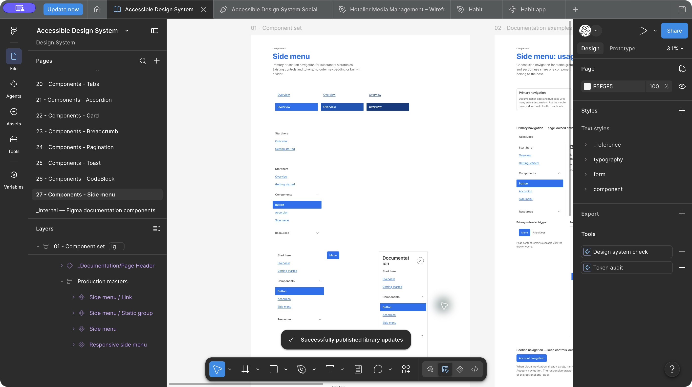

# Side menu — original delivery and validation evidence

The approved current-state and child-indent revision is documented in [the current treatment evidence](side-menu-current-treatment.md). Historical test counts and publication receipts below describe the original delivery.

Date: 27 October 2026. Local review base: `d87d53f12597e573ea90769b38a6442b4478b3cb`.
Implementation merged through [PR 49](https://github.com/richardstelmach/accessible-design-system/pull/49), merge `984e95215eb370a0129ab4baf45c968ab0af3a95`. GitHub Actions run `40534165465` passed every core job step. Richard accepted the local design/API review and authorized GitHub/Figma delivery.

## Delivered behaviour and ownership

- `SideMenu` provides native nav/list/link semantics, static groups and actual independent Accordion groups. One group level; no ARIA menu/tree roles. Core padding is zero, with no built-in sidebar divider.
- Optional native `aria-label` is omitted by default. Different navigation purposes require distinct names, for example Main navigation and Account navigation. Responsive `label` remains the required visible drawer title and does not implicitly name its inner nav.
- `ResponsiveSideMenu` composes existing Button/Dialog for the modal drawer and an existing outer Accordion for in-flow navigation. Group headings are explicit; the bounded outer H2/group H3 composition is documented in the Accordion contract. General recursive nesting remains excluded.
- Primary drawer controls render in the host header through `drawerTriggerContainer`; section and in-flow controls remain local. The host owns column geometry, focus clearance, separators, valid destinations, route state, titles and destination focus. Successful routing can close and focus main; failed/cancelled routing retains access.
- Current links use the shared selected default/hover/active family already used by Pagination, with strong text and aria-current=page. Ordinary links remain underlined; current links have no underline or decorative left bar. Accordion controls retain their neutral treatment.
- Removed uncontrolled groups discard expansion state. Group choices otherwise survive placement and outer closing. Resizing preserves focused navigation in both directions; only an open modal pins compact placement. An open inline Menu becomes persistent above lg once focus safely leaves.
- Baseline/no-JavaScript navigation exposes every destination; print reveals closed groups and hides shell controls. The preview's empty presentation prompt safely resolves to the default drawer.

Usage boundaries are recorded in [the component guidance](../../components/side-menu/side-menu.md), [contract](../../components/side-menu/side-menu.yaml) and [side-navigation pattern](../../patterns/side-navigation.yaml): documentation-heavy sites, B2B applications and substantial sections; prefer top navigation for a short shallow hierarchy. This is not a generic sidebar, command menu, in-page contents list, tree or sequential task navigator.

## Source validation

- **130 unit tests across 12 files passed**; full browser suite **98/98 passed**, including nineteen SideMenu checks. GitHub CI independently passed build, typecheck, unit, preview build, browser, packed consumers and unchanged compiled-token checks.
- Coverage includes controlled decline, independent groups, current-branch updates, removed/reinserted groups, explicit heading hierarchy, one mounted tree, unique IDs, optional landmark names and drawer-title independence.
- Browser checks cover header/local placement, modal focus/inertness/Tab boundary, Close/Escape/backdrop, scroll and focus restoration, accepted/failed/modified/same-destination navigation, safe breakpoint transitions, empty preview selection, neutral controls and current default/hover/pressed states.
- Geometry and accessibility checks cover zero core padding/border; page-only divider; drawer text alignment and bounded header gap; 320px RTL long labels; enlarged text and spacing; print; no JavaScript; forced colours; axe and rendered contrast.
- Library and production preview builds, type declarations and packed **React 18.3.1 / 19.3.1** consumers passed, including imports, SSR/hydration, refs and public API fixtures. Package contains 72 files. No package publication occurred.
- Text contrast for selected states: **4.52:1 default, 7.00:1 hover, 10.87:1 pressed**. Focus uses the existing ring/separator family; current state receives a full system-colour border in forced colours.
- YAML/JSON parsing and diff whitespace checks passed. Canonical build retains 409 raw / 337 Studio tokens, 24 mapped responsive groups, zero unmapped groups and zero broken retained aliases. Compiled tokens have no diff; no dependencies changed.

The earlier responsive Breadcrumb/Pagination timeout did not recur in the complete passing run. No existing regression was weakened.

## Figma implementation and audit

[Figma page: 27 - Components - Side menu](https://www.figma.com/design/dVFI0q1cXMtmjUAkdvSWkk?node-id=1570-296).

| Object | ID |
| --- | --- |
| Component area | `1570:297` |
| Documentation examples | `1571:385` |
| QA and responsive tests | `1571:742` |
| Accessibility notes | `1571:1764` |
| Side menu / Link | `1570:368` |
| Side menu / Static group | `1570:369` |
| Side menu | `1570:389` |
| Responsive side menu | `1570:1258` |

The Link set has six Current × State variants and independent Focus. Label remains an exposed existing Link property. Responsive Layout has Persistent, Drawer closed/open and Inline closed/open states, with reused nested controls exposed for editing. Native Items/Links/Content slots remain intact.

Existing Accordion, Accordion / Item / Title, Link, Button, Dialog, IconButton, Modal backdrop and documentation components remain linked instances. Only the existing Accordion root description (`1176:183`) changed, to align its API and bounded navigation nesting guidance; its visual masters/runtime were not changed.

Documentation uses four existing Page Header instances and seventeen existing Card instances in wrapping grids. Examples cover documentation-primary, B2B-primary, account-section, page-owned divider, header/local triggers and both compact presentations. QA covers selected pointer/focus states, flat/static/mixed groups, 320/390px wrapping, RTL links, enlarged text/spacing and a 768px viewport with the existing backdrop and a 512px maximum drawer surface.

The final structural audit found **1,710 editable nodes, zero image-filled nodes, Inter throughout, zero missing text styles and zero slot-limit violations**. All 102 referenced variable IDs resolve, including eighteen inherited remote references. Core padding is `[0,0,0,0]` with zero strokes. Ordinary/current underline treatment matches React. All six link masters are 51px high at lg, above the comfortable target minimum. Global and Breakpoint collections retain their existing IDs and base/md/lg modes.

No variables, tokens or production text styles were created. Ordinary links reuse the existing Pagination link text style, compatible with the local always-underlined navigation recipe; current links use the existing strong body style. One explicitly QA-only reference style represents intentional 200% text/spacing overrides. Existing legacy foundation metadata was preserved; no broad token migration was performed.

Visual checks passed after targeted auto-layout and typography fixes. Reviewed IDs: primary desktop/mobile `1571:404`, B2B/section `1574:876`, QA `1571:742`, RTL/enlarged text `1574:1334`, tablet/backdrop `1575:1125`, accessibility `1571:1764`. The [machine-readable receipt](react-side-menu-figma-evidence.json) records exact IDs, bindings, variants, inherited variable resolution and counts. Figma states illustrate the contract; they do not implement native modal, routing or assistive-technology behaviour.

## Prepublication parity repairs

Final review found three Figma-only differences, now repaired without React, canonical-token or production-component changes:

- **Drawer sizing:** the Dialog surface had no maximum width and retained a fixed 720px height. It now binds max width to existing `component.dialog.size.small` (512px) and fills the authoring viewport height. A scrollable layout frame in the existing Content slot keeps navigation beneath the reachable header/Close control. The tablet backdrop composition also fills its viewport correctly.
- **Flat-list spacing:** Items previously applied 16px after every child. Its gap now binds to existing `spacing.0`. Existing static/Accordion group instances use layout wrappers with `spacing.stack.md` bottom padding only when another item follows; the final group has no trailing inset. The default grouped layout retains its previous positions and height.
- **Target dimensions:** all six link masters now bind both minWidth and minHeight to existing `size.target.comfortable` (44px), matching React.

Temporary-instance regressions passed at **320 × 560, 390 × 720, 512 × 400, 768 × 560 and 1280 × 900**. Surface widths were respectively **320, 390, 512, 512 and 512px**, with surface height equal to each viewport height. All six link variants clamped an undersized 32 × 24 request to 44 × 44. Existing flat QA rows now sit at y=0, 51 and 102 with zero gaps. Group spacing remains 16px after each non-final group. Every temporary instance was removed.

Fresh local checks passed: library/token build, type checks, **130 unit tests** and **19/19 side-menu browser checks**, including axe/contrast, focus, reflow and responsive transitions. YAML/JSON parsing, local documentation links and diff checks passed; compiled tokens remain unchanged. The evidence PR runs the full GitHub suite separately.

The updated live audit reports 1,710 editable nodes, 17 existing documentation Card instances, all 102 variable references resolved, zero missing text styles/component references/slot-limit violations and no image-filled nodes. Existing master IDs, six link variants, five responsive states, fonts and collections/modes are preserved. No token, production text style or component was added. Two group layout frames, a scrollable content frame and linked QA/documentation instances implement the repairs.

Visual check passed for [the short-drawer/flat-list regression section](https://www.figma.com/design/dVFI0q1cXMtmjUAkdvSWkk?node-id=1591-1432). The receipt records the repair mutations, current native-slot identities and full measured matrix. Richard subsequently accepted the final review and authorized library publication; see the publication receipt below.

## Sync and remaining checkpoints

GitHub source and Figma construction/audit are complete. Documentation/evidence delivery is recorded by the accompanying PR. Token sources and compiled outputs are unchanged, so no Tokens Studio provider pull/export or destructive reconciliation is required. Figma library publication is complete; no npm package publication occurred.

Richard reports successful local screen-reader and keyboard testing; platform, browser and assistive-technology versions were not specified. Actual 400% browser zoom, real touch, Windows high contrast and targeted browser/AT combinations remain release acceptance where not already checked. Figma's forced-colour example is a structural reference, not an OS palette simulation.

The viewport-based wrapper is intended for page/application shells. Hosts remain responsible for desktop working width, stable mounted header slots and focus when destinations/permissions change. Narrow embedded layouts can compose the core directly. Synced project references remain untouched.

## Figma library publication

On 27 October 2026, following Richard's acceptance, Figma published the four Side menu assets plus the existing Accordion description update. The publication review contained exactly these five component changes, with no style or variable changes selected; 132 unchanged and 48 hidden assets were excluded. The QA-only reference typography remains hidden.

Figma displayed **Successfully published library updates**. A subsequent live API check returned **CURRENT** for Side menu / Link (`1570:368`), Side menu / Static group (`1570:369`), Side menu (`1570:389`), Responsive side menu (`1570:1258`) and Accordion (`1176:183`). Component IDs and keys are preserved in the [publication receipt](react-side-menu-figma-evidence.json).

The source and Figma repairs remain covered by [PR 51](https://github.com/richardstelmach/accessible-design-system/pull/51), merge `255972e20dbd0c1daa5f2dd0f5f65d59de14391f`, with successful full CI run `40547140937` (130 unit tests, 98 browser tests and packed React 18/19 consumers). Publication changes no React implementation, tokens or dependency components. Contract/evidence parsing, relative documentation links, token rebuild and diff checks are rerun for this documentation update; the new PR runs the full CI suite independently.

Publication does not change the remaining actual zoom/device/AT acceptance described above or publish the npm package.
