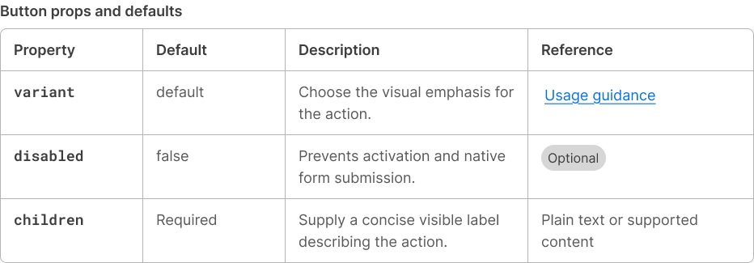
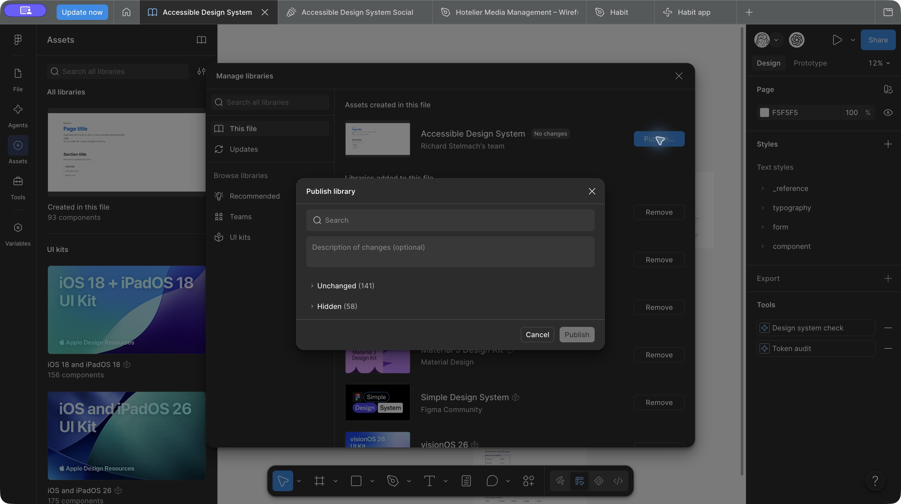

# Table — merged source and published Figma evidence

Date: 29 October 2026. [PR 54](https://github.com/richardstelmach/accessible-design-system/pull/54) merged as `c2ccbe50d4869e42ade43d859f947cf32355a732` after Richard accepted the final source/Figma review. [GitHub run 40869492358](https://github.com/richardstelmach/accessible-design-system/actions/runs/40869492358) passed on final head `0de1fe0540faa9b7ea12b0cd539822de375ffde2`. Runtime and preview checks were run in an isolated checkout at `42992b38ae2da2d3841fc4b46f70a4f5d25550e4`; subsequent documentation and native focus fallback changes are covered by the final GitHub checks. The three Table assets and shared inline-code-strong style are now published in Figma. Site adoption is a separate consumer update; deployment and npm publication remain separate.

## Source outcome

Native Table export with required visible or explicitly visually hidden caption, author-owned header scopes and native content, HTMLTableElement ref, bounded readable-column overflow and existing-token border/divider treatment. Wrapper has no role/name/tabindex. The native table owns measured keyboard focus and a hidden referenced scroll description, merged with author aria-describedby IDs. Focus retention, fallback and print preserve access. No sorting/grid/selection or new token.

Richard confirmed the native-focus revision works with VoiceOver/Chrome. Earlier focusable-wrapper interaction failures and the correction are recorded in [local evidence](react-table-local-candidate.md); those historical states are not the final contract.

## Completed source checks

- Exact isolated source: build, type checks, 137 unit tests across 13 files, all 110 browser checks, preview build and packed React 18.3.1/19.3.1 consumers passed. Package contains 74 files.
- The optional :has focus selector is isolated behind @supports, preserving a separately parsed native-table fallback. All ten Table browser checks passed again after this CSS-only refinement; GitHub checks the final PR head.
- No dependencies changed; rebuilt compiled tokens have no diff. No npm publication.
- Review axes: Standards found no hard documented violations; Spec found no runtime mismatch. A malformed test fragment introduced during diagnostic exclusion was corrected, and the isolated full browser suite passed. The preview's named section was also removed so its headings add no automatic region landmark.
- Local colour experiments, VoiceOver diagnostic page, private recordings and extracted media remain outside the PR. The private site/logo checkout was unchanged during component delivery; later adoption is tracked separately.

## Figma result

[28 - Components - Table](https://www.figma.com/design/dVFI0q1cXMtmjUAkdvSWkk?node-id=1618-6) is published. [Machine-readable receipt](react-table-figma-evidence.json) includes the node ledger, responsive cases, reused components, bindings and derived style IDs.

| Asset | ID |
| --- | --- |
| Component area | 1618:7 |
| Documentation examples | 1618:14 |
| QA and responsive tests | 1618:21 |
| Accessibility notes | 1618:28 |
| Table | 1618:56 |
| Table / Row | 1618:42 |
| Table / Cell set | 1618:41 |
| Header / Data cells | 1618:35 / 1618:38 |

The four areas reuse actual Documentation Page Header/Card masters (four headers and ten cards). Eleven Table instances reuse actual Link and neutral Badge instances. Header/Data cell distinction follows native cell roles; no Table breakpoint/column-count/data-count variants. All 274 text nodes have shared styles after audit.

Cell padding binds existing inset.sm/md (12px/16px). Borders, dividers, radius, surfaces and foregrounds bind existing variables. Rows grow naturally and all cells stretch to the same row height; repeated columns align. Visible captions remain bounded in responsive illustrations. Caption content, Rows and Cells are Figma authoring slots; React still takes a required caption string/native children. Show caption is a boolean.

The shared inline-code-strong style composes the existing code font with responsive body size and strong weight; private QA stress styles express enlarged text and spacing. These add shared Figma styles, **no token or variable**. Global and Breakpoint collection identities and base/md/lg modes are unchanged; 360 local variables remain. No existing variable scopes/codeSyntax were rewritten; broad foundation metadata reconciliation is outside this component change.

QA includes 320px base, 768px md, fitting lg, long caption/unbroken content, RTL illustration, enlarged text, spacing, visible keyboard focus and eight-column comparison. Horizontal clipping is intentional and prototype frames allow horizontal scrolling; each viewport grows to its full table height. Browser-native ch sizing, header announcements, word spacing, keyboard scrolling and print are established through code/manual checks, not claimed from Figma pixels.

[Responsive QA render](table-figma-qa.png) · [Accessibility guidance render](table-figma-accessibility.png)

## Remaining gates

Source review, merge and Figma publication are complete. Site adoption is tracked separately. Wider manual checks remain VoiceOver/Safari, NVDA, actual zoom, touch devices and Windows high contrast. Existing token metadata was preserved, not broadly re-audited or reconciled. No Tokens Studio sync is required because token sources did not change.

## Publication receipt

On 29 October 2026, Richard authorized merge and publication. Figma’s review contained exactly **four changes**: Table, Table / Row, Table / Cell and `component/table/inline-code-strong`. The ten private Table QA styles remained hidden; no variables or unrelated assets were selected. After the Publish action, all three component assets reported **CURRENT**, with their original IDs and keys preserved. The publication review then showed **141 unchanged, 58 hidden, no changes**, and disabled Publish. Text styles have no publication-status method; style publication is established by its selected change and the empty post-publication review.

No tokens changed, so no Tokens Studio pull/export was needed. No npm release or deployment occurred.
