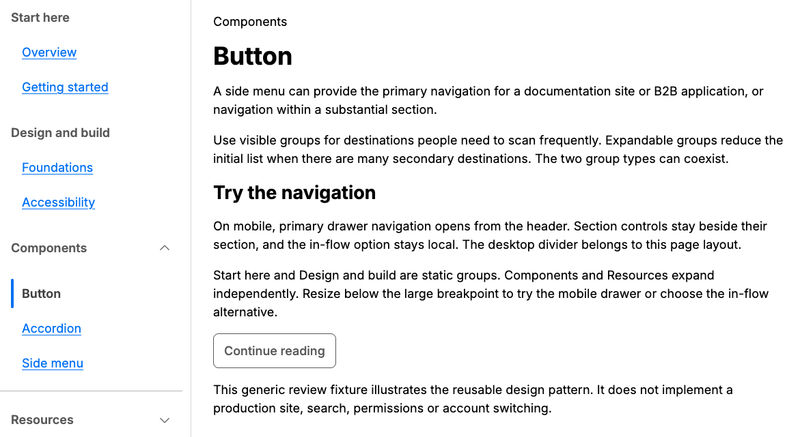
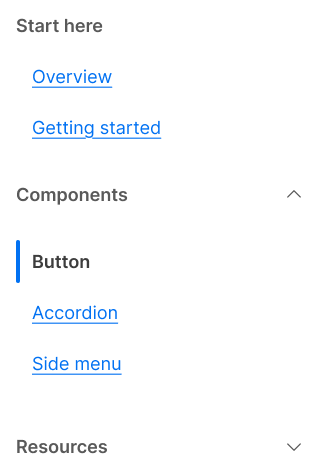

# Side menu current state and hierarchy

27 October 2026. Approved local design promoted from library baseline `4d0fd6646036e41dcc1e52800f402e5b87952ea6`. This supersedes the filled-current and unindented-child descriptions in the original Side menu delivery receipt.

## Component change

Current destinations retain `aria-current="page"`, strong text and no underline, with dark `color.text.heading` text and a 4px logical leading rule. The existing selected background, hover.background and active.background tokens colour the rule. Neutral surface/default interaction tokens colour the row. No token values, aliases, public APIs or dependencies changed. Pagination and selected form controls retain their filled states.

Hover requires `(hover:hover) and (pointer:fine)`; touch release returns to the rest surface without blurring focus. Static and Accordion child lists use one `spacing.inset.md` (16px) logical indent. Top-level destinations and captions stay aligned. Nav padding remains zero, with the divider owned by page composition. Drawer captions align with its title; children sit one indent deeper. Existing Link, Accordion, Button and Dialog are reused.

| State | Text contrast | Rule contrast against row |
| --- | --- | --- |
| Rest | 10.86:1 | 4.52:1 |
| Hover | 7.47:1 | 4.82:1 |
| Pressed | 5.30:1 | 5.30:1 |

Focus remains independent. Forced colours retain the complete system-colour current border plus a CanvasText marker. RTL places both marker and indentation at inline-start.

## Validation

- Build, typecheck, 130 unit tests and 100 browser tests pass.
- Browser regressions verify actual rest/hover/pressed marker and row colours, independent keyboard focus, repeated touch taps, equal static/Accordion indentation in LTR/RTL, and drawer title/parent/child geometry.
- A strengthened forced-colour regression also verifies the marker stays CanvasText while hovered and pressed. Existing suite covers 320px wrapping, enlarged text/spacing, no-JavaScript, print, forced colours, axe, modal lifecycle, accepted/cancelled routing and responsive focus safety.
- Packed React 18.3.1 and 19.3.1 consumers pass; archive contains 72 files. No npm publication.
- Token build and diff checks confirm all canonical and compiled tokens unchanged. Existing Vite ignored `use client` warnings remain.
- Richard accepted the local appearance and previously reported successful component screen-reader/keyboard use. Real-device touch, platform-specific assistive technology and actual 400% zoom remain manual acceptance; emulation is not a substitute.

## Figma alignment

[Side menu page](https://www.figma.com/design/dVFI0q1cXMtmjUAkdvSWkk?node-id=1570-296). Existing four asset IDs and keys are preserved: Link `1570:368`, Static group `1570:369`, Side menu `1570:389`, Responsive side menu `1570:1258`. No variables, text styles, production variants or shared-control masters were added. Existing variants gain variable-bound markers; child content slots use the existing indent variable.

[Structural receipt](side-menu-current-figma-evidence.json) records current state geometry, 27 indented content slots, linked component reuse and resolved local/remote variables. Existing persistent, drawer and inline layouts retain their dimensions and native slots. Optional landmark naming, independent drawer title, scope/ownership and accessibility notes remain aligned.

Figma cannot override the transform of a descendant inside an instance. Its RTL QA reference therefore retains the linked Link instance and mirrors its marker in a QA-only layout wrapper; React uses logical geometry directly. The forced-colour reference remains illustrative; runtime system colours are browser-owned.

No token changes means no Tokens Studio pull/export is required. The four modified Side menu assets were published on 27 October 2026 and all report CURRENT with their original keys. The 133 unchanged and 48 hidden assets were excluded; no styles or variables were published. See the structural receipt.

